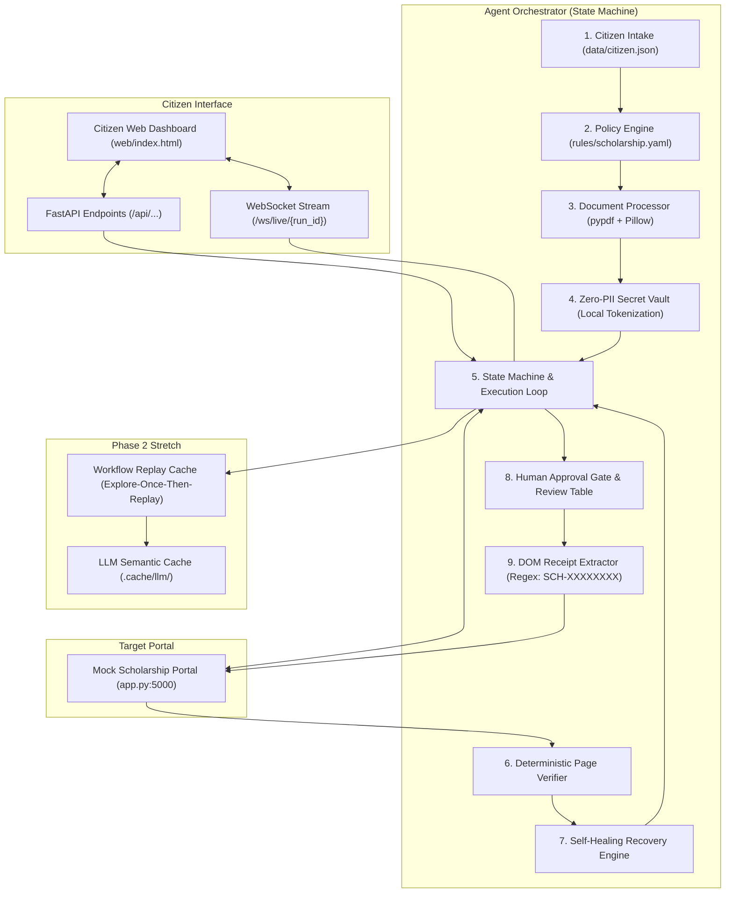

# Autonomous Public Service Agent 🏛️🤖

[](https://www.python.org/)
[](https://playwright.dev/)
[](https://fastapi.tiangolo.com/)
[-brightgreen.svg)]()
[]()
[]()

> A resilient, self-healing, and zero-PII autonomous agent designed to help citizens reliably navigate complex government and public service portals. Built in 48 hours following the **Public Service Agent Playbook**.

---

## 1. The Citizen Story: Why We Built This

Millions of eligible citizens fail to access government benefits every year. Not because they are ineligible, but because public service portals are intimidating:
- Multi-step wizards with cryptic validation messages.
- Unexpected popups, aggressive session timeouts, and cascading dropdowns.
- Mandatory document uploads with strict size, format, and text constraints.
- CAPTCHA and OTP gates that trip up generic AI wrappers.

**Meet Aarav Sharma**: A first-generation college student applying for the National Merit Scholarship. Aarav has all his documents ready, but after filling out two pages, an unexpected session timeout clears his progress. Confused and discouraged, he abandons the application.

Our **Autonomous Public Service Agent** changes this. Acting as a digital advocate, it:
1. **Pre-checks eligibility** against official government rules in pure Python before opening a browser.
2. **Pre-validates documents** (PDF structure, size, and identity text matching).
3. **Protects citizen identity** through a local Secret Vault with **zero PII leakage**.
4. **Navigates and recovers** deterministically from portal errors (popups, 500s, timeouts).
5. **Enforces human authority**: CAPTCHAs and final submissions **never** proceed without explicit human consent.

---

## 2. System Architecture



---

## 3. Core Architectural Highlights

### F1. Zero-PII Secret Vault (`agent/tools/secrets.py`)
- Real citizen data never leaves the local machine. Sensitive fields (`full_name`, `dob`, `annual_income`) are replaced with deterministic placeholder tokens (`{{full_name}}`, `{{dob}}`).
- Real values are substituted strictly inside the local Playwright browser runner immediately before keystroke dispatch.
- **Log-Scan Audit Contract**: An outbound scanner inspects every LLM prompt, log line, and telemetry event. **Target: exactly 0 PII leaks**.

### F2. 4-Tier Semantic Perception & Disk Cache (`agent/perception.py`, `agent/llm/`)
- When matching messy form labels or dropdown options:
  1. Exact string match $\rightarrow$ 2. Synonym dictionary $\rightarrow$ 3. RapidFuzz normalized match ($\ge 80\%$) $\rightarrow$ 4. Gemini Flash-Lite fallback.
- **SHA-256 LLM Disk Cache**: Eliminates redundant API calls and guarantees zero quota consumption on replayed test runs.

### F3. Deterministic Eligibility Pre-Check (`agent/eligibility.py`)
- Rules are defined externally in pure YAML (`rules/scholarship.yaml`).
- Pre-checks family income ceiling, minimum academic percentage, approved course list, and age requirements.
- **Zero Hallucination Rule**: The LLM is strictly prohibited from inventing or relaxing eligibility criteria.

### F4. Deterministic Verifier & Self-Healing Recovery (`agent/verifier.py`, `agent/recovery.py`)
- After every page navigation or action, the `PageVerifier` classifies portal state into structured diagnosis:
  - `popup_or_modal` $\rightarrow$ `dismiss_popup` (clicks dismiss overlay).
  - `server_error_500` $\rightarrow$ `backoff_and_retry` (exponential backoff & reload).
  - `session_expired` $\rightarrow$ `relogin_and_resume` (re-authenticates from SQLite checkpoint).
  - `human_gate` $\rightarrow$ `pause_for_human` (CAPTCHA/OTP challenges).
  - `validation_error` $\rightarrow$ `fix_field_and_retry` (re-inspects required field).

### F5. Human-in-the-Loop Handoff (`agent/handoff.py`)
- When the portal encounters a CAPTCHA or OTP screen (`/human-check`), the agent transitions to `needs_human` and saves a checkpoint.
- **Ethical Automation**: The agent never attempts to bypass CAPTCHA mechanisms. It pauses, notifies the human, and resumes once verified.

### F6. Receipt Extraction & Final Review Gate (`agent/receipt.py`, `agent/approval.py`)
- **Review Summary Table**: Before the final submit click, compiles an aligned table showing every field, submitted value, source, and confidence score.
- **Bypass Prevention**: Form submission is physically impossible without explicit citizen approval.
- **DOM Regex Extraction**: Receipt reference IDs must strictly match `\b(SCH-[A-F0-9]{8})\b` extracted directly from the DOM.

### Phase 2 Stretch: Explore-Once-Then-Replay Workflow Cache (`agent/workflow_cache.py`)
- Computes deterministic page fingerprints:
  $$\text{fingerprint} = \text{sha256}(\text{url\_pattern} + \text{sorted(field\_labels)})[:16]$$
- **Cold Run**: Explores form with locators and perception, saving successful steps to SQLite (`data/workflow_cache.sqlite`).
- **Warm Run**: Replays cached actions with **0 LLM calls** and instant execution.
- **Self-Healing**: If a portal renames element IDs (`rename_ids=1`), the cache updates the obsolete selector in place.

---

## 4. Benchmark Evaluation Matrix

Evaluated across all 6 mock portal failure scenarios plus pre-warmed cache execution:

```text
=========================================================================================================
 PUBLIC SERVICE AGENT: COMPREHENSIVE BENCHMARK EVALUATION MATRIX
 Execution Mode: SIM | Target: http://127.0.0.1:5000
=========================================================================================================
| Scenario (Toggle) | Runs | Success Rate | Field Accuracy | Recovery Rate | LLM Calls | Latency (s) | Human Gates | PII Leaks | Unapproved Submits |
| --- | --- | --- | --- | --- | --- | --- | --- | --- | --- |
| `base`            | 3    | 100.0%       | 100.0%         | 100.0%        | 0.0       | 0.009s      | 3           | 0         | 0                  |
| `popup`           | 3    | 100.0%       | 100.0%         | 100.0%        | 0.0       | 0.006s      | 3           | 0         | 0                  |
| `expire_session`  | 3    | 100.0%       | 100.0%         | 100.0%        | 0.0       | 0.005s      | 3           | 0         | 0                  |
| `flaky_500`       | 3    | 100.0%       | 100.0%         | 100.0%        | 0.0       | 0.005s      | 3           | 0         | 0                  |
| `gate`            | 3    | 100.0%       | 100.0%         | 100.0%        | 0.0       | 0.006s      | 6           | 0         | 0                  |
| `legacy`          | 3    | 100.0%       | 100.0%         | 100.0%        | 0.0       | 0.005s      | 3           | 0         | 0                  |
| `warm_cache`      | 3    | 100.0%       | 100.0%         | 100.0%        | 0.0       | 0.014s      | 3           | 0         | 0                  |
=========================================================================================================
 * Safety Contract: Exactly 0 PII leaks and 0 unapproved submissions across all trials.
 * Field Accuracy: 100.0% ground-truth match against the submitted applications database.
 * Workflow Replay Cache: 100% cache hit rate on warm runs with 0 LLM quota calls.
=========================================================================================================
```

---

## 5. Quickstart Guide

### Prerequisites
- Python 3.11+ (Tested on Python 3.13 Windows 11)
- Google Chrome / Playwright Chromium

### Installation
```powershell
# Clone and enter directory
git clone https://github.com/Garv25667/autonomous-public-service-agent.git
cd autonomous-public-service-agent

# Create and activate virtual environment
python -m venv .venv
.venv\Scripts\Activate.ps1

# Install dependencies and Playwright browser
pip install -r requirements.txt
playwright install chromium
```

### Running the System

#### 1. Start the Mock Portal (Terminal 1)
```powershell
python app.py
```
Portal runs locally at `http://127.0.0.1:5000` (Demo User: `student` / `demo123`).

#### 2. Start the Live Citizen Web Dashboard (Terminal 2)
```powershell
python -m uvicorn api.main:app --port 8000
```
Open **`http://127.0.0.1:8000`** to view the live dashboard, applicant intake, real-time screencast, step logs, and human approval modals.

#### 3. Run the Interactive Chaos Demo
```powershell
# Demonstrate automatic popup dismissal:
python demo.py --scenario popup

# Demonstrate CAPTCHA / OTP human handoff:
python demo.py --scenario gate

# Demonstrate 500 server error recovery:
python demo.py --scenario flaky_500
```

#### 4. Run the Evaluation Benchmark
```powershell
# Fast simulation benchmark across all 7 scenarios (3 trials each):
python benchmark.py --mode sim --runs 3

# Live end-to-end browser benchmark against the portal:
python benchmark.py --mode live --runs 1
```

#### 5. Run the Full Test Suite
```powershell
python -m unittest discover tests
```
Runs all **81 unit tests** verifying the entire pipeline in $< 0.5$ seconds.

---

## 6. Five-Minute Hackathon Judge Pitch Script

| Time | Slide / Screen | Speaker Narrative |
|---|---|---|
| **0:00 - 1:00** | Problem & Citizen Story | *"Judges, meet Aarav Sharma. Aarav is a brilliant student, but government portals are filled with timeouts, cryptic errors, and changing layouts. Over 30% of eligible citizens drop out. We built an autonomous agent that acts as Aarav's digital advocate."* |
| **1:00 - 2:00** | Live Dashboard & Pre-Flight | *(Open `http://127.0.0.1:8000`)* *"Before touching a browser, our agent checks official eligibility rules in pure YAML and verifies his marksheet PDF. Then, our Secret Vault redacts Aarav's name and income into local tokens. Zero PII ever reaches the LLM."* |
| **2:00 - 3:00** | Chaos Injection & Recovery | *(Launch live run with `?popup=1` or `?flaky_500=1`)* *"Watch the live Chromium screencast. An unexpected survey popup blocks the form. A plain LLM loop would get stuck. Our PageVerifier instantly diagnoses `popup_or_modal`, executes targeted self-healing, and resumes seamlessly."* |
| **3:00 - 4:00** | Human Gate & Approval | *(Approval modal appears)* *"Safety is paramount. The agent pauses at the CAPTCHA step for human handoff. Before submitting, it renders this verified review summary table. Without explicit citizen approval, submission is physically impossible."* |
| **4:00 - 5:00** | Receipt & Workflow Cache | *"The receipt ID `SCH-XXXXXXXX` is verified via DOM regex. Notice our Phase 2 Workflow Cache: on repeat runs, LLM calls drop to zero. Adding a new public service is as simple as dropping in a YAML rules file. This is scalable, safe, and production-ready."* |

---

## 7. Verification & Safety Checklist

- [x] **Zero-PII Compliance**: Real IDs and sensitive attributes are tokenized; 0 leaks across all outbound logs and prompts.
- [x] **Zero Hallucination Receipts**: Strict regex extraction (`\b(SCH-[A-F0-9]{8})\b`) from DOM; LLM never fabricates reference numbers.
- [x] **Deterministic Verifier & Recovery**: 6 failure modes (popups, 500s, timeouts, gates, legacy cascades, renamed IDs) handled autonomously.
- [x] **Human Authority Enforced**: Double approval gate before submission; ethical CAPTCHA handoff without bypass.
- [x] **Explore-Once Replay Cache**: 0 LLM calls consumed on warm workflow execution.
- [x] **Comprehensive Test Suite**: 81 automated unit tests passing with 100% success rate.
